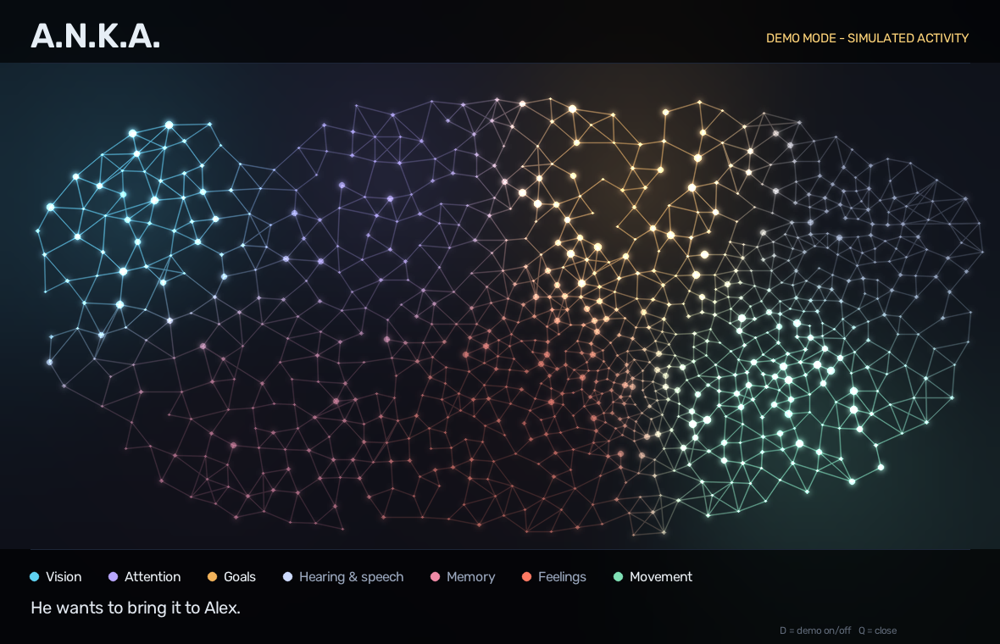

# Status – what works, how well, and what's next

*Last updated: 18 November 2026.*

Everything below was measured in simulation: the 2D room and Pollen's MuJoCo simulator. **Nothing has run on a real
Microduck yet**, so treat every number as "works in the simulator". Most comparisons are 3 runs against 3 runs, so a
difference is a strong hint, not proof. The language model answers differently every time.

The tool that does the measuring is `tools/score_run.py`. It reads the thought traces (`test_logs/trace_*.jsonl`) and
counts what he actually did: actions, failures, repeats, goals, feelings, memory use, cost. No AI judges anything.

This page is the current state. The history, including the experiments that failed and what they taught us, is in
[docs/JOURNAL.md](docs/JOURNAL.md).

---

## ✅ Done and working

### Thinking and feeling

| Feature | How well (measured) |
|---|---|
| **Thinks on his own** (thought → feeling → act → speak, every 4–16 s) | Stable through all runs. Since 2026-11-15 the day brain is `gemini-3.5-flash-lite`: about $0.12 for a 17-minute 3D day (was about $0.17 with `gemini-3-flash-preview`), with answers in 1–1.5 s. His spoken lines are a bit shorter and plainer. |
| **Speaking is optional** (most thoughts stay in his head) | Alone, he says about 60 % fewer things out loud (2–9 lines in 5 min instead of 14–17). With people around he is as chatty as before. |
| **Feelings that fade slowly** ("after-feelings") | 2 minutes after an apology his nervousness was 0.70, against 0.09 without the feature (no overlap between runs). His thoughts stay careful ("Alex is nice again, but I'm still shaky"). His actions changed only a little: he was a bit quieter and kept more distance. |
| **Do the feelings change what he does?** | When he is alone and nothing happens, **yes**. With loneliness held high he walked 11–16 m and explored once. With it held low he walked 19–27 m and explored 3 times (no overlap). When something happens (a shout), the event itself decides his first reaction, not the feeling numbers. |
| **Expectation and surprise** | He states an expectation on 93–98 % of his actions. Big surprises go into his diary, and after one, his next action is different 78–100 % of the time. Over three days in one life his surprise went from 0.28 to 0.11 to 0.04: he learned to predict better. |
| **Wiser brain when stuck** (2 misses in a row → `gemini-4-argon` for that one thought) | He solved "the ball is stuck in the corner" the same day (he carried it instead of kicking it) in 3 of 3 runs, against 2 of 8 with only the day brain. It costs a little more per day: the bigger model is used only for those thoughts. |
| **Knowing when he's alone** | He no longer thinks someone has left just because they are out of view. Only a departure he heard counts (footsteps, the door). |
| **Feelings colour what he remembers** (2026-11-15) | How he feels also picks which memories come up (lonely → lonely memories). Alone, he walked 9.7–12.5 m with it against 2.3–8.8 m without (no overlap, 3 vs 3). In the longer life tests the difference was mixed. On by default (`--no-mood-memory` turns it off). |
| **Restless when nothing happens** (2026-11-18) | A fact line, not an order: how long he has been still with nothing new. Off/on: `--no-restless`. |
| **The human's last words fade** (2026-11-18) | When Alex leaves, his goodbye is shown in Anka's thoughts for 2 minutes instead of 30. Together with restlessness, 3 days alone: walked **17.2 m a day** (still 49 % of the time), against 7.7 m (still 67 %) before both. He no longer gives up after day 1. Restlessness itself fired in only 0–11 % of his thoughts, so most of the gain is this fix. |
| **Cloud fallback** (2026-11-16) | When Google says "too busy" (HTTP 429), the thought goes to another cloud model (`CLOUD_FALLBACK`) before the weak local brain. |

### Memory

| Feature | How well |
|---|---|
| **Memory by meaning** (facts, diary, conversations, with the feeling of each) | Works. Strong moments come back more easily. |
| **Habituation** (a memory that just came up pulls weaker for a while) | The most-repeated memory went from 28 of 30 thoughts to 7–12 of 22–35. Variety of memories went up from 0.19 to 0.27–0.40. |
| **Memories from earlier days** (life mode: several days in a row) | 46–84 % of the memories shown come from earlier days, instead of 0–19 %. He says things like "I remember my red ball was near the sofa yesterday." |
| **Picture memories** (he chooses to keep what he sees; an old picture comes back next to the current one) | Works. He keeps about 10 pictures in a 17-minute day once he is told how many he has kept. |
| **Memory strength** (2026-11-18) | Memories fade with a half-life (7 days × how strong the memory is). Strong moments start stronger, and every time a memory comes up it gets stronger. When memory is full, the weakest go first. `--no-memory-strength` turns it off. |
| **Memories kept forever** (2026-11-18) | The night may mark up to 2 memories a night "⭐ kept forever". They never fade and are never deleted. |
| **Getting to know things** (2026-11-18) | He is told only what is *new* today ("everything else here you know well"). The share of thoughts about his one most-thought-of thing went from 44–54 % to 30–33 % (two versions, 6 + 12 runs). `--no-familiarity` turns it off. |

### Nights

| Feature | How well |
|---|---|
| **Night review** | Mistakes are judged only from what the day showed. Wrongly deleted memories went from 3 to 0 over three nights. A promise or a plan is never treated as a mistake. Since 2026-11-18 it also sees what his body really did, and a missing report is never proof of a mistake (it had deleted true kick memories). |
| **Self-image from his body's track record** | His beliefs about himself now match what his body really did. He stopped believing "I can climb the bookshelf" after a day of failing to. |
| **Lessons and ideas** | Untested ideas ("Maybe I could carry the ball…") are kept apart from lessons. Every time a night wrote an idea, he tried it the next day (2 of 2). When it was the right idea, the ball was delivered in 18 s. **But this is not yet a proven gain in performance:** in the ball transfer test the group *without* experience was faster (13 s against 17–133 s), and with ideas the results overlap with the control. He only learns from what he actually tried, and a success the night doesn't write down is lost. Details in the [journal](docs/JOURNAL.md#-ball-transfer-test-the-control-group-was-faster). |
| **Lessons as experiences** (2026-11-18) | Lessons used to be written as orders ("I should wait quietly") and one made him sit still for two days. Now the night writes what happened, in its situation ("When I walked up to the guitar, I could see its strings"), never a lesson to do nothing, and a lesson is only shown when it fits the moment. `--no-lesson-fix` turns it off. |
| **Dreams** | Written by the night model from the day's strongest moments and the pictures he kept. |

### Body: 2D simulator
- He walks, turns, looks, picks up and carries, kicks, sits, explores, and runs errands ("bring me the sock").
- **His own map:** step counting, an EKF with 5 landmarks, a floor plan from his depth sensor, and fixed walls. At the end of a test his position is typically 3–12 cm off.

### Body: MuJoCo simulator (Pollen's real duck software)
- **Walking, turning, looking, sitting, exploring:** works. His position at the end of a 17-minute day is 5–13 cm off.
- **The living body between thoughts:** before it, he stood completely still 97 % of the time between his own moves. Now it is 20–25 %, and never more than a few seconds in a row. It does glances, head tilts, weight shifts, breathing, small turns of the body towards where he looks, and his eyes follow a ball that rolls.
- **Feelings in the body (the `BODY` line):** he writes it on almost every thought and reply. When shouted at he wrote "Crouched low, head tucked down, trembling", and the body did that.
- **Pollen's 13 emotions** (sad, laugh, yes, no, excited …), a peck (bending down), and 7 duck sounds: all of them are his own choice, as actions.
- **His real voice in the simulator,** with a mute button in the room window.
- **One window for the 3D simulator** (2026-11-12): the room, his floor plan, his camera and the log together, as big as your screen allows (also on Retina screens). It runs as its own program, so it doesn't slow his thinking down. Sound starts muted; click the button or press M to hear him.
- **The kick works sometimes:** he walks up to the ball, takes the last few centimetres without seeing it (the camera can't see that close) and kicks. After five rounds of fixes (2026-11-16/18) he lines up in 5 of 28 tries (was 1 of 55), and is told where the ball really is instead of "you can't see it".
- **The real duck's camera** (2026-11-18): the simulator now uses the retail Microduck's camera (GC2093, about 86° × 55°, upright), taken from Pollen's own code. `ANKA_CAMERA=prototype` gives the old one.
- **The window** fills 80 % of your screen, with his camera, the facts he gets and the depth sensor side by side.

### Watching him
- **The brain view** (2026-11-18): a window that shows which parts of Anka are busy (vision, attention, goals, memory, movement, feelings, hearing), with light running through a net of neurons in waves. Click **BRAIN VIEW** in the simulator window (or press B), or start `tools/Anka brain window.command` (add `demo` for a demo). It only *shows* what happens: it reads a small file Anka writes and never changes what he does. A browser version is in `app/viz/index.html`.

### Using him
- **A start menu** (`Anka menu (mac).command`, `Anka menu (linux).sh`, `Anka menu (win).bat`, all starting `app/anka_menu.py`; built 2026-11-11). The main folder only has these three and the text files; everything else is in `app` (2026-11-13). The menu clears the screen between steps.: starts every mode, checks what is installed and offers to fix it (environment, packages, Ollama and its memory model, his voice, the Gemini key), and finds and tests a real Microduck on your wifi. Tested on macOS; Linux and Windows untested.

---

## 🔧 Should be fixed

- **The kick lines up only about 1 time in 5.** The most common failure now: after turning, he looks down and misses the ball. Left for later, and to be re-tested with the new wider camera.
- **Alone, he still misses Alex a lot.** About 40 % of his thoughts on a day alone are about Alex. It no longer stops him, but nothing else pulls him yet. This grew from his own nights (he wrote "I feel lonely when Alex goes out" himself) – the kind of personality from experience the project is after, just too strong for now.
- **No beak motor in the simulated duck,** so in 3D he can peck but not carry anything. The real duck has one.
- **He talks a lot when people are around:** about 16–19 lines of his own in 5–6 minutes. A lesson about it exists, he is reminded of it, and it barely changes his behaviour.
- **He chooses a lot of duck sounds** (30–40 in 17 minutes). Telling him the count worked for picture memories; it may be needed here too.
- **`BODY` words are read with word lists.** The vocabulary is limited ("tail wagging" means nothing to a body without a tail). When he sits, only the head can show his feelings.
- **The reserve brain** (Qwen3.5-4B, 3-bit, local) is too weak to run all of Anka. When the network drops, his behaviour gets odd, so those stretches are left out of the scores.
- **Small local layers didn't help yet.** A small local model (`gemma3:1b`) writing his wishes (`URGE_MODE`) or memory search words (`--assoc`) gave generic, repeated words. Both are off by default; the code is kept for a better small model.
- **The code has grown fast.** `anka/body.py` (the 2D body) is 170 KB. The 2D and 3D bodies share ideas but not code. There are many small test scripts, and `settings.py` is long.
- **Small samples:** most experiments are 3 runs against 3 runs.
- **Only tested on macOS.** Sound now has a Linux and a Windows path (`anka/sound.py`), and the rest is plain Python, but nobody has run Anka on Linux or Windows yet.

## 📋 Next

The work goes on in the simulator until the real duck arrives, and this repository is updated along the way.

**In the simulator (now):**
1. **More of what a mind has built in:** reflexes, a base mood, memories of pain, habits and a stable self – one at a time, measured.
2. **Memories as whole episodes,** not single lines.
3. **The kick again,** with the new wider camera.
4. **Self-paced thinking:** he chooses when his next thought comes (soon / in a while / when something happens), instead of a fixed timer.
5. **Goals with reasons:** why he wants something, and checking that later.
6. **Richer body language:** a better reading of his `BODY` words, more use of Pollen's emotions, and fewer but better-chosen sounds.
7. **A better transfer test:** does experience beat common sense in a new situation?
8. **Tidy the code:** split the big files, and share more between the 2D and 3D bodies.
9. **Flowing conversation** with a live voice model, where he can be interrupted.

**When the real duck arrives** (expected around March 2027):
- Run `ankasim/simbody.py` against the real robot: the same JSON-RPC calls, a real camera, a real depth sensor.
- Energy: his real battery as a drive (waits for the real duck).
- Test what only real hardware can show:
  - the camera floor test,
  - depth from the camera (Depth Anything V2),
  - YOLO for things in the room,
  - hearing where a voice comes from,
  - hands-free listening,
  - the beak.

**Later:** a stronger local brain (more RAM, or a brain on board the duck), and emotion steering vectors for the local model.
