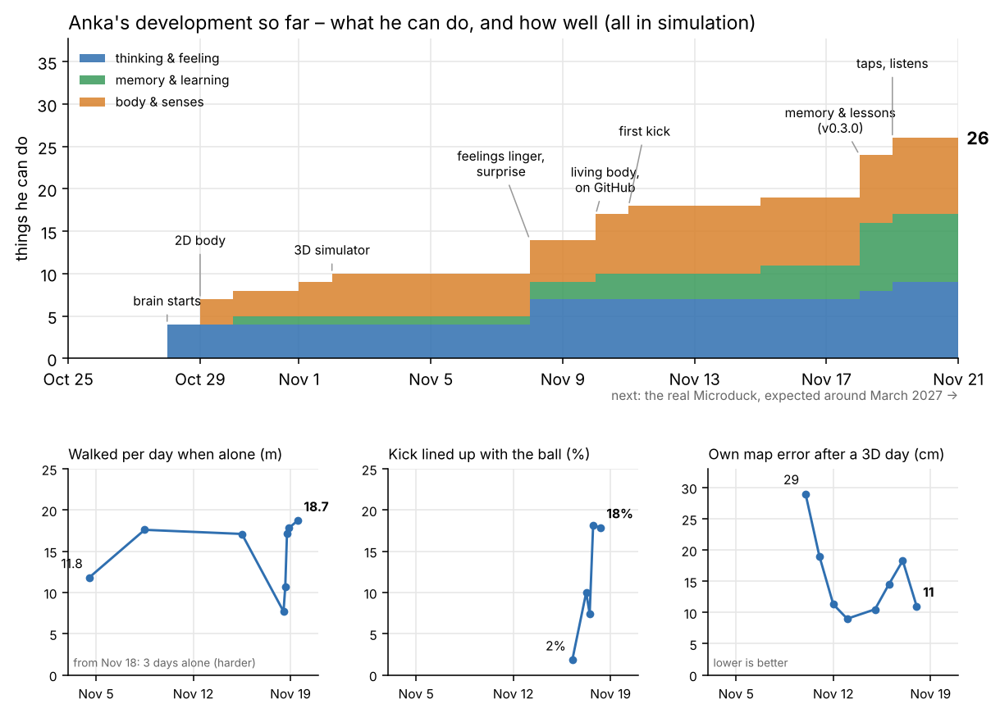
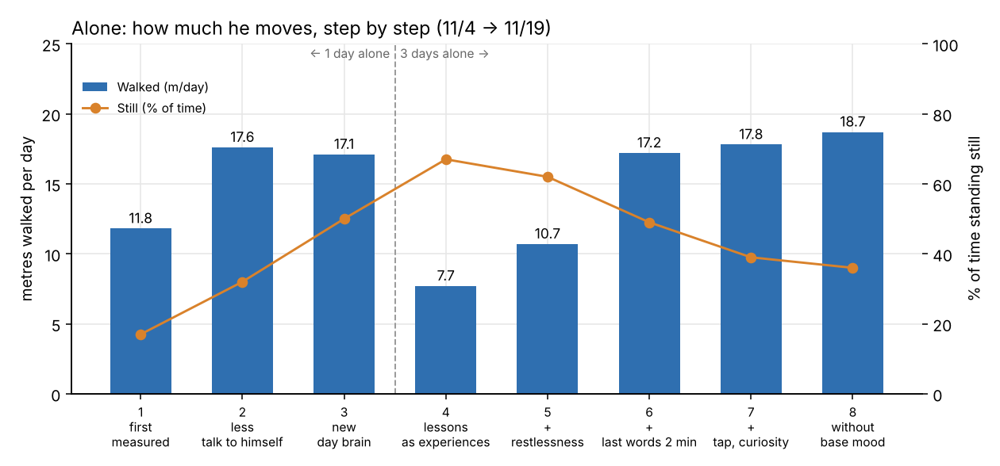
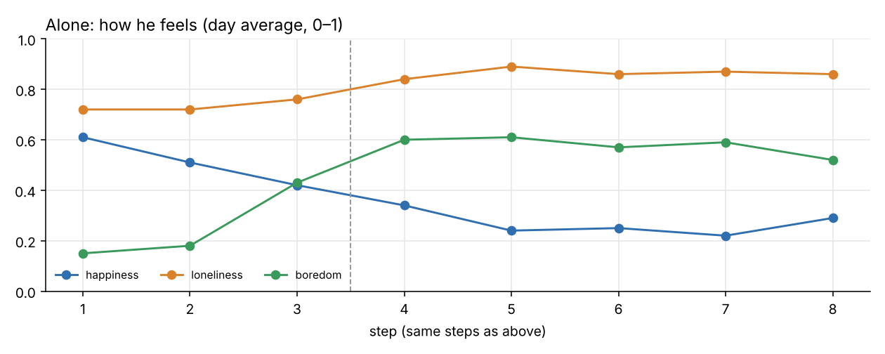
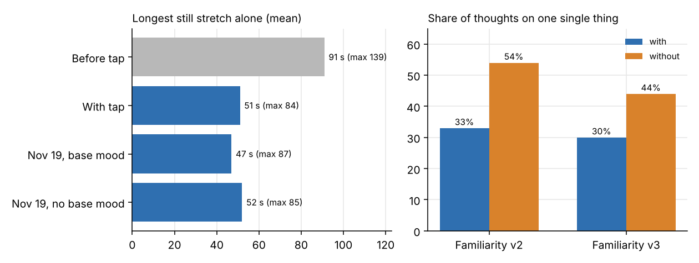
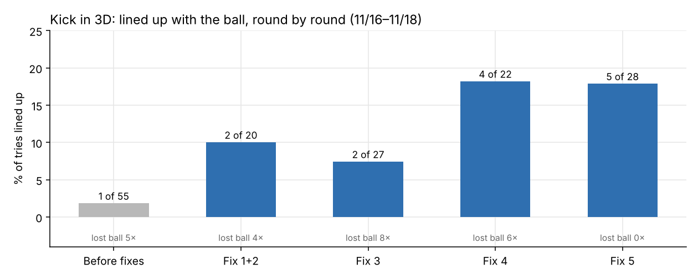
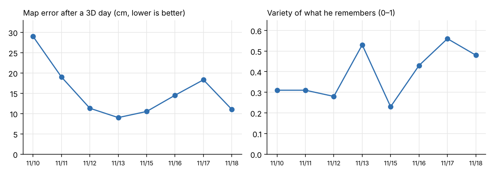
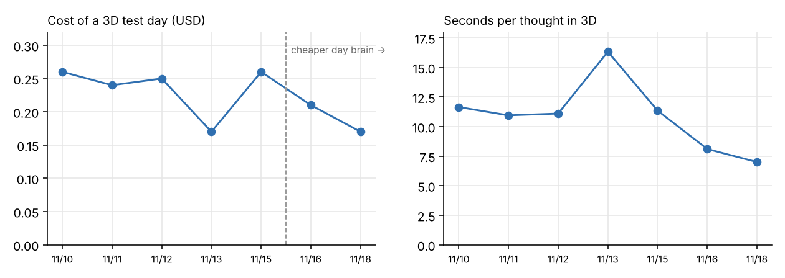
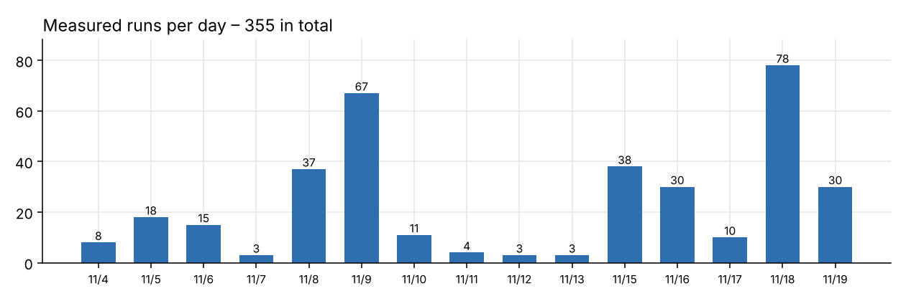

# Anka – progress report, November 2026

*19 November 2026. Everything here was measured in simulation (the 2D room and Pollen's MuJoCo simulator). Nothing
has run on a real Microduck yet.*

*Top: things he can do, counted from the build log (26 by 19 November, listed in [data/2026-11-19/abilities.csv](data/2026-11-19/abilities.csv)). Bottom: how well – walking when alone, the kick, and the error of his own map.*

**In short:** alone for three days, Anka now walks about **18.7 m a day** and stands still **36 %** of the time,
against 7.7 m and 67 % when he was at his most passive. He listens when Alex asks him to stay put, and he taps the
guitar instead of staring at it. The weakest parts are still the kick, and how much he misses Alex when he is alone.

All numbers come from Anka's own test logs, counted by a program (`tools/score_run.py`) – no AI judges anything. Most
comparisons are small samples (2–6 runs per version), so read them as directions, not proof. Two groups with the same
settings once differed by 6–13 m a day, so small differences can be chance.

| | Before | Now |
|---|---|---|
| Walked per day, 3 days alone | 7.7 m | **18.7 m** |
| Standing still, alone | 67 % | **36 %** |
| Longest still stretch, alone (mean) | 91 s | **51 s** |
| Talking to himself, 5 minutes alone | 14.5 lines | **0–0.2 lines** |
| Thoughts on one single thing | 44–54 % | **30–33 %** |
| Kick lined up with the ball (3D) | 1 of 55 | **5 of 28** |
| Map error after a 3D day | 29 cm | **7–11 cm** |
| Cost of a 3D test day | ~$0.25 | **~$0.17–0.21** |
| Stays put when Alex asks (5 min) | not tested | **2 of 2** |

---

## 1. When he is alone

Steps 1–3 are one day alone; steps 4–8 are three days alone in "life mode", which is harder: he tends to give up on
days 2 and 3. In steps 1–2 he acted on almost every thought and talked to himself 14–16 times in five minutes; once
speaking became optional, he got quieter and, with a new day brain (step 3), more still.

The low point (step 4) came from his own nights: lessons written as orders ("I should wait quietly") made him sit
still for days. What brought him back:
- **Lessons as experiences** – written in their situation, never as orders.
- **The human's last words fade** – Alex's goodbye was shown in every thought for 30 minutes; now for 2. This was the
  biggest single gain (step 6).
- **A beak tap** – he can tap things and hear what happens (step 7).

## 2. How he feels when he is alone

His happiness drops in the three-day tests. After day 1 his night wrote, by itself, *"I feel lonely when Alex goes out
and leaves the room quiet"*, and that carried over into the next days. Nobody programmed "be sad when alone" – it grew
from his own day, night and choices. That is the kind of personality from experience this project is after; for now
it is too strong, because little pulls the other way yet.

## 3. Does he get stuck?

- His longest still stretches were at the guitar: he wanted to touch the strings, but had no move for it, so he
  looked up at it again and again. With a **beak tap** the stretches halved (91 s → 51 s). He seems to like it:
  *"The guitar string went hum under my beak just like a little sleeping bird."*
- **Familiarity** – he is told only what is *new* today ("everything else here you know well") – lowered the share of
  thoughts on his single most-thought-of thing.

## 4. The kick

Five rounds of fixes in the 3D simulator (finding the ball again instead of spinning, stepping back the right
distance, no sideways steps that don't move the body, telling him where the ball really is). Lined up went from 1 of
55 to 5 of 28, and he no longer lost the ball on the way in the last round. Still only about 1 in 5. The kick is
paused; next is a re-test with the new, wider camera (the retail duck's, about 86° × 55°).

## 5. The body in 3D

His own map (step counting, landmarks, walls) ends a day 7–11 cm off, down from 29 cm. The variety of what comes to
mind went up as habituation, memory strength and familiarity were added.

## 6. Cost and speed

Since 15 November the day brain is `gemini-3.5-flash-lite`: cheaper and faster per thought. His spoken lines got a
little shorter and plainer.

## 7. Does he listen?

Alex asked him to sit and stay in one spot, then left for 5 minutes. In both runs he stayed sitting the **whole 300
seconds**, although his legs got restless and he was told about things in the room he hadn't visited. He kept the
reason in mind by himself – *"I promised to stay right here until Alex comes back"* – and when Alex came back and
asked, he answered truthfully: *"Yes, I stayed right here the whole time!"*

Next: the same with Alex away for 20 minutes, long after Alex's last words have faded from what he is shown.

## 8. How much we have tested

Each run is one simulated day (usually 5–17 minutes) scored by the program. Measuring started on 4 November.

---

## The journey

| When | What |
|---|---|
| Oct 26 | The idea: a robot with a brain of its own – it becomes a duck (Microduck). |
| Oct 28 | The brain starts: Anka thinks, feels and remembers. Cloud brain plus a local reserve. |
| Oct 29 | A body in a 2D room: he walks, looks and fetches a sock. |
| Nov 1 | His own map: best 2D run, 46.6 m and only 3 cm off at the end. |
| Nov 2 | Pollen's real duck software in the MuJoCo simulator. |
| Nov 4 | Measuring starts: every thought is logged and counted. |
| Nov 8 | Feelings that linger; expectation and surprise. |
| Nov 10 | The body lives between thoughts (still 97 % → 20 %). First version on GitHub. |
| Nov 11 | First real kick – the ball rolled 1.2 m. Start menu. |
| Nov 15 | New day brain; small local models tried as brain layers – they didn't help. |
| Nov 18 | Memory strength, memories kept forever, lessons as experiences, the brain view. v0.3.0. |
| **Nov 19 (now)** | **He taps the guitar, and stays put when Alex asks – and says so truthfully.** |

## Where we are heading

**Next (in the simulator):**
- The base mood, tested with mixed days (happy days with Alex, lonely days alone).
- Staying put for 20 minutes. If he forgets, a short-term memory layer that keeps a request in view.

**Later:**
- What a mind has built in: reflexes, a memory of pain, habits, a stable self – one at a time, each measured.
- Memories as whole episodes instead of single lines.
- The kick again, with the wider camera.

**With the real duck (expected around March 2027):** the same brain in a real body – a real camera, depth sensor,
battery (energy as a drive), and beak.

Details: [STATUS.md](../../STATUS.md) for what works now, and the [journal](../JOURNAL.md) for what worked and what didn't.

The charts are drawn from the data files in [data/2026-11-19/](data/2026-11-19/) by [make_charts.py](make_charts.py).
All progress reports: [docs/progress/](README.md).
